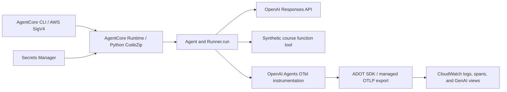

# Chapter 10 · Lab 12: OpenAI Agent on AgentCore Runtime with ADOT

Deploy one OpenAI Agents SDK agent with a synthetic course lookup tool, then
find its model and tool activity in Amazon CloudWatch. OpenAI performs
inference. Amazon Bedrock AgentCore Runtime hosts the service and supplies
runtime credentials, session isolation, and telemetry export configuration.

## Architecture



`agent.py` exposes the actual SDK `Agent`, `function_tool`, and `RunConfig`.
`runtime_app.py` calls `Runner.run` directly. The only deterministic catalog
data lives inside the tool; the deployed flow always uses the SDK/model loop.

## Setup and local verification

Use Python 3.12 and an isolated environment; this lab does not use the root
workspace's older SDK lock. Run all commands in this reference directory.

```bash
cd chapter-10/lab-12-agentcore-runtime/reference-solution
uv venv --python 3.12 .venv
uv pip sync --python .venv/bin/python requirements.lock
uv pip install --python .venv/bin/python -r requirements-dev.txt
.venv/bin/python -m pytest -q
env -u OPENAI_API_KEY -u OPENAI_API_KEY_SECRET_ARN .venv/bin/python run_reference.py
```

Offline tests exercise the real SDK loop and function tool with a mock HTTP
transport, inspect real framework spans with an in-memory exporter, and test
ADOT CLI startup with console export. They require neither API keys nor AWS
credentials. The no-key demo exits successfully with `SKIP`.

The live model test skips by default. With `OPENAI_API_KEY`, opt in using
`RUN_AGENTCORE_OPENAI_SMOKE=1 .venv/bin/python -m pytest -q tests/test_openai_integration.py`.
It makes OpenAI requests and verifies a real tool result; it does not deploy
to AWS.

To try a real model locally, set `OPENAI_API_KEY` in your environment, then:

```bash
.venv/bin/python run_reference.py "What does the observability course cover?"
```

For a local HTTP server with console telemetry:

```bash
OTEL_PYTHON_DISTRO=aws_distro OTEL_PYTHON_CONFIGURATOR=aws_configurator \
OTEL_PYTHON_DISABLED_INSTRUMENTATIONS=openai_agents \
OTEL_TRACES_EXPORTER=console OTEL_METRICS_EXPORTER=none OTEL_LOGS_EXPORTER=none \
OTEL_AWS_APPLICATION_SIGNALS_ENABLED=false AGENT_OBSERVABILITY_ENABLED=false \
AWS_EC2_METADATA_DISABLED=true OTEL_SERVICE_NAME=lab12_local \
.venv/bin/opentelemetry-instrument .venv/bin/python runtime_app.py
```

In another terminal:

```bash
curl http://localhost:8080/ping
curl http://localhost:8080/invocations -H 'Content-Type: application/json' \
  -d '{"prompt":"What does the observability course cover?"}'
```

Plain `python run_reference.py` uses a no-op OTEL provider unless a provider
is configured externally; its trace ID is then all zeros. The ADOT server
command above prints valid trace IDs and spans to the console. CloudWatch
export is configured by the managed deployment below.

## How instrumentation reaches CloudWatch

The pinned `opentelemetry-instrumentation-openai-agents` package registers a
tracing processor that translates SDK callbacks into OTEL spans. The explicit
line in `telemetry.py` uses `replace_existing_processors=True`, routing SDK
traces through OTEL instead of also sending them to the OpenAI dashboard.
The API key is configured with `use_for_tracing=False`.
The deployment disables auto-discovery for `openai_agents` only, avoiding
duplicate registration. Other ADOT instrumentation remains active.

Keep `RunConfig.tracing_disabled=False`: disabling SDK tracing suppresses the
callbacks the instrumentor needs. ADOT configures the tracer provider,
AWS-authenticated export, and managed runtime resource identity. This lab does
not create a second provider or run a separate collector. AWS documents the
[ADOT SDK path](https://docs.aws.amazon.com/bedrock-agentcore/latest/devguide/observability-configure.html)
and [OpenAI Agents instrumentation support](https://docs.aws.amazon.com/bedrock-agentcore/latest/devguide/supported-frameworks-openai-agents.html).

The CLI runtime configuration enables OTLP traces/structured logs, Python logging
instrumentation, and ADOT's EMF metrics exporter. AgentCore also publishes
service metrics independently of the agent's framework spans.

`session.id` baggage and the invocation span's session attribute allow request
correlation. The SDK `group_id` also equals the runtime session ID. Runtime
sessions do not automatically supply SDK conversation history: this example
is stateless per turn. The returned `otel_trace_id` is the OTEL ID for
CloudWatch lookup; it is distinct from an OpenAI SDK trace ID.

## Deploy with the AgentCore CLI

Use the current Node-based [`@aws/agentcore` CLI](https://github.com/aws/agentcore-cli),
pinned to **0.31.1** for this lab. The similarly named Python starter toolkit
has different commands and configuration. Install Node.js 20 or newer, `uv`,
AWS CLI v2, and the CLI:

```bash
npm install -g @aws/agentcore@0.31.1
agentcore --version
```

Students use Python **CodeZip** deployment: the CLI packages Linux ARM64
wheels, uploads the artifact, and manages the runtime and IAM role through
its generated CDK project. This path needs no Docker or ECR setup. See the
[AWS Python deployment guide](https://docs.aws.amazon.com/bedrock-agentcore/latest/devguide/runtime-get-started-code-deploy-python.html).

You need an AWS account, an AgentCore-supported commercial Region, and an
OpenAI key with access to the selected model. Authenticate using your normal
AWS profile; for SSO, run `aws sso login --profile YOUR_PROFILE` and export
`AWS_PROFILE=YOUR_PROFILE`. The deployer needs AgentCore, CloudFormation,
CDK bootstrap/S3 asset, IAM role/policy and `iam:PassRole` permissions, plus
Secrets Manager secret creation and CloudWatch/X-Ray/Application Signals
permissions. The CLI can bootstrap CDK on first deployment; an organization
may require an administrator to bootstrap beforehand. Consult the
[CLI permissions guide](https://github.com/aws/agentcore-cli/blob/main/docs/PERMISSIONS.md).
Runtime, OpenAI requests, Secrets Manager, S3 assets, and CloudWatch telemetry
incur usage charges. Runtime sessions have a five-minute idle timeout and
thirty-minute maximum lifetime.

### 1. Select the account and store the OpenAI key

From this reference directory, with the local environment already installed,
select your SSO profile and refresh its login (replace `YOUR_PROFILE`):

```bash
export AWS_PROFILE=YOUR_PROFILE
aws sso login --profile "$AWS_PROFILE"
aws sts get-caller-identity --profile "$AWS_PROFILE" --query Account --output text
```

Continue only when STS succeeds and prints your 12-digit account ID. Creating
an SSO profile does not make it the active profile for subsequent commands.
Keep `AWS_PROFILE` exported so AWS CLI, boto3 helpers, and AgentCore CLI use
that profile. Then select the Region and create the secret:

```bash
export AWS_REGION=us-east-1
export AWS_DEFAULT_REGION="$AWS_REGION"
export LAB12_ACCOUNT_ID="$(aws sts get-caller-identity --query Account --output text)"
export LAB12_SECRET_ARN="$(.venv/bin/python store_secret.py --region "$AWS_REGION")"
```

The secret helper reads `OPENAI_API_KEY` or prompts without echo, and prints
only the ARN. To reuse a secret, set `LAB12_SECRET_ARN` to its ARN instead of
running the helper. Its JSON must contain `{"OPENAI_API_KEY":"..."}` and the
secret must be in the selected account/Region. The generated additional IAM
policy grants `secretsmanager:GetSecretValue` on that ARN alone and S3 read
access to ZIP assets in this account/Region’s default CDK asset bucket. The
lab uses the default CDK bootstrap qualifier `hnb659fds`; for custom bootstrap
configuration, adjust the asset-bucket ARN in `prepare_cli.py` before preparation.
Secret access assumes
AWS-managed encryption; a customer-managed KMS key also needs scoped
`kms:Decrypt` permission and key-policy authorization.

### 2. Prepare the CLI project and deploy

```bash
.venv/bin/python prepare_cli.py --account-id "$LAB12_ACCOUNT_ID" \
  --region "$AWS_REGION" --secret-arn "$LAB12_SECRET_ARN"
cd deployment/Lab12
agentcore deploy
agentcore status --runtime CourseAssistant --json
```

`prepare_cli.py` runs `agentcore create --no-agent`, copies four runtime source
files, and configures the BYO runtime in `agentcore/agentcore.json`. It performs
local preparation and validation only. It places all pinned transitive
requirements into `app/CourseAssistant/pyproject.toml`, which the CLI's
CodeZip packager reads. Tests, `.venv`, local credentials, and development
helpers are excluded. Inspect the generated project before deployment:

- `agentcore/agentcore.json`: CodeZip, Python 3.12, HTTP, IAM authentication,
  public egress, ADOT configuration, and session lifetimes.
- `agentcore/aws-targets.json`: your account and Region.
- `app/CourseAssistant/policies/openai-secret.json`: scoped key access.

The source configuration is [deployment-config.json](deployment-config.json).
It sets `instrumentation.enableOtel=true`, causing the CLI's generated runtime
entrypoint to launch through `opentelemetry-instrument`. The explicit Agents
instrumentor then uses ADOT's provider. The runtime supplies exporter endpoints
and resource identity; preserve those managed values. Public networking allows
OpenAI egress while inbound calls remain authenticated with IAM. The key's ARN
appears in configuration; the key itself stays in Secrets Manager. Inference calls OpenAI. The CLI’s generated default role also includes Bedrock
model permissions and configuration-bundle permissions; this lab does not use
those permissions. Inspect the generated role in accounts that require tighter
IAM policies. Traces use `always_on` sampling for this small lab.

For packaging without creating cloud resources, run
`agentcore package --runtime CourseAssistant`. This downloads dependencies and
builds the Linux artifact locally. `agentcore validate` checks project schema.

The CLI attempts to enable CloudWatch Transaction Search after deployment,
including Application Signals discovery and trace indexing. This is an
account/Region setting. If the CLI reports a permissions warning, have an
administrator follow the [AWS setup procedure](https://docs.aws.amazon.com/bedrock-agentcore/latest/devguide/observability-configure.html#observability-configure-builtin-cw)
before the telemetry acceptance test. Allow approximately ten minutes after
first enablement, then invoke again. A successful deploy with a setup warning
does not establish that spans are queryable.

The lab retains synthetic content with
`AWS_GENAI_CONTENT_EXTRACTION_OPT_OUT=true` and `TRACELOOP_TRACE_CONTENT=true`,
plus SDK sensitive-data inclusion. This supports inspection of the mock tool
result. For other datasets, choose content-capture settings deliberately;
`TRACELOOP_TRACE_CONTENT=false` suppresses content in this instrumentor.

### 3. Invoke twice with one runtime session

Keep running these commands inside `deployment/Lab12`:

```bash
export LAB12_SESSION_ID="$(python3 -c 'import uuid; print(uuid.uuid4())')"
agentcore invoke --runtime CourseAssistant --session-id "$LAB12_SESSION_ID" \
  --prompt 'What does the observability course cover?' --json
agentcore invoke --runtime CourseAssistant --session-id "$LAB12_SESSION_ID" \
  --prompt 'What does the deployment course cover?' --json
```

The CLI signs calls with your AWS credentials and resolves the deployed ARN.
The caller needs `bedrock-agentcore:InvokeAgentRuntime` on the runtime; it does
not need the OpenAI key. The UUID satisfies the 33–256 character session
requirement. Read the agent response inside the CLI's JSON result:
`final_output`, `last_agent`, `tool_outputs`, `runtime_session_id`,
`otel_trace_id`, and token usage. The optional `invoke_runtime.py` demonstrates
the equivalent boto3 call when an explicit ARN is useful.

### 4. Inspect CloudWatch and capture evidence

```bash
agentcore logs --runtime CourseAssistant --since 1h --json
agentcore traces list --runtime CourseAssistant --since 1h --json
# Replace the example with the agent response's 32-character OTEL trace ID:
agentcore traces get REPLACE_WITH_RETURNED_OTEL_TRACE_ID \
  --runtime CourseAssistant --output trace.json
```

The CLI queries CloudWatch. Also open
[CloudWatch GenAI Observability](https://console.aws.amazon.com/cloudwatch/home#gen-ai-observability)
in the deployment Region and inspect sessions/traces. Transaction Search lets
you locate the returned trace ID and examine span details. Allow several
minutes for ingestion. See [AWS viewing instructions](https://docs.aws.amazon.com/bedrock-agentcore/latest/devguide/observability-view.html).

Verify these before claiming cloud success:

- Both responses contain synthetic course data and a captured tool output.
- Both responses share the session ID and have different OTEL trace IDs.
- Each trace includes an agent span (`invoke_agent`), model span (`chat`),
  and `get_course_info` tool span (`execute_tool`) in `gen_ai.operation.name`.
- Model spans include model/token metadata; tool spans show the synthetic data.
- Runtime logs and service metrics are visible in CloudWatch. Locate the
  runtime log group using CLI status/log output or the CloudWatch console;
  record its exact name for cleanup. Unified spans use its `spans` stream;
  other delivery configurations may use shared `aws/spans`.

A shared runtime session does not supply SDK conversation history: this
agent is stateless per turn. The returned ID is an OTEL ID for CloudWatch,
distinct from an OpenAI SDK trace ID. Service metrics alone do not demonstrate
framework instrumentation.

### 5. Update the agent

Edit the original `agent.py` in the reference directory, then refresh the
prepared project and deploy again:

```bash
cd ../..
.venv/bin/python prepare_cli.py --account-id "$LAB12_ACCOUNT_ID" \
  --region "$AWS_REGION" --secret-arn "$LAB12_SECRET_ARN"
cd deployment/Lab12
agentcore deploy
```

The helper preserves CLI deployment state and refreshes the copied sources.
Use a fresh session ID to verify the new version. Use `--model MODEL_ID` at
preparation time to select another available OpenAI model. The service loads
the secret at startup, so rotate it and start new runtime sessions when
changing the key. Keep `deployment/` ignored; do not edit the copied source as
your primary source of truth.

## Troubleshooting

| Symptom | Check |
| --- | --- |
| Preparation rejects the CLI | Install `@aws/agentcore@0.31.1`; the Python starter toolkit is a different CLI |
| Package fails | `uv` on PATH, dependency download access, pinned wheels for Python 3.12/Linux ARM64 |
| Runtime startup fails | `agentcore logs`; secret ARN/JSON/Region, execution role policy, package entrypoint |
| `MissingDependencyException` for login provider | Sync the lab lockfile, which includes `botocore[crt]`/`awscrt`; export the intended `AWS_PROFILE` |
| `CreateOAuth2Token` invalid grant | This indicates the AWS-login credential flow; select your SSO profile with `AWS_PROFILE` and refresh it with `aws sso login --profile YOUR_PROFILE` |
| Account ID must contain exactly 12 digits | The STS command failed, leaving the account variable empty; fix authentication, rerun STS, and recompute `LAB12_ACCOUNT_ID` before preparation |
| Deployment `AccessDenied` | Deployer/CDK bootstrap/IAM permissions, `iam:PassRole`, selected AWS profile |
| OpenAI authentication/model error | Secret key and model access; rerun preparation with `--model` and redeploy |
| Logs/metrics without framework spans | `enableOtel=true`, explicit instrumentor, SDK tracing enabled, Transaction Search setup warnings |
| Duplicate framework spans | Keep `openai_agents` disabled in automatic discovery; explicit registration occurs once |
| All-zero trace ID locally | Use the documented ADOT server command; plain Python has no configured provider |
| Trace not found | Wait for ingestion, confirm Region/session, enable Transaction Search and invoke again |
| Deployment rollback | Read CLI/CloudFormation events, correct permissions/package/Region, retry deployment |

## Cleanup

Inside this dedicated CLI project, preview and then remove its resources:

```bash
agentcore remove all --dry-run
agentcore remove all
agentcore deploy
```

`remove all` clears local resource declarations. The following `deploy`
performs stack teardown when no deployable resources remain. **Both commands
are necessary**. Keep the prepared project and its CLI state until cloud
teardown succeeds; verify the runtime has disappeared in the AgentCore
console. Do not rerun `prepare_cli.py` during cleanup because it restores the
runtime declaration.

Delete only the dedicated secret created for this lab:

```bash
aws secretsmanager delete-secret --region "$AWS_REGION" \
  --secret-id "$LAB12_SECRET_ARN" --recovery-window-in-days 7
```

If the runtime log group was retained, delete its recorded exact name using
`aws logs delete-log-group --region "$AWS_REGION" --log-group-name YOUR_LAB_LOG_GROUP`.
Keep reused secrets, shared `aws/spans`, CDK bootstrap resources/assets, and
account-wide Transaction Search settings. Dedicated secrets remain
recoverable during the seven-day window; retained/shared telemetry follows
its configured retention policy.

## Sources and verification limits

Documentation checked on 6 October 2026:

- [OpenAI SDK quickstart](https://developers.openai.com/api/docs/guides/agents/quickstart)
- [Official SDK checkout](../../../replay-environment/.agents/skills/openai-agents-sdk/openai-agents-python)
- [AgentCore CLI Python deployment](https://docs.aws.amazon.com/bedrock-agentcore/latest/devguide/runtime-get-started-code-deploy-python.html)
- [CLI commands](https://github.com/aws/agentcore-cli/blob/main/docs/commands.md)
- [CLI configuration](https://github.com/aws/agentcore-cli/blob/main/docs/configuration.md)
- [CLI Transaction Search setup](https://github.com/aws/agentcore-cli/blob/main/docs/transaction_search.md)
- [AgentCore HTTP contract](https://docs.aws.amazon.com/bedrock-agentcore/latest/devguide/runtime-http-protocol-contract.html)

See [BUILD-LOG.md](BUILD-LOG.md) for actual checks. Local SDK/span tests and
CLI packaging do not prove AWS permissions, managed ADOT export, or CloudWatch
ingestion. Complete the live evidence checklist after deploying.
